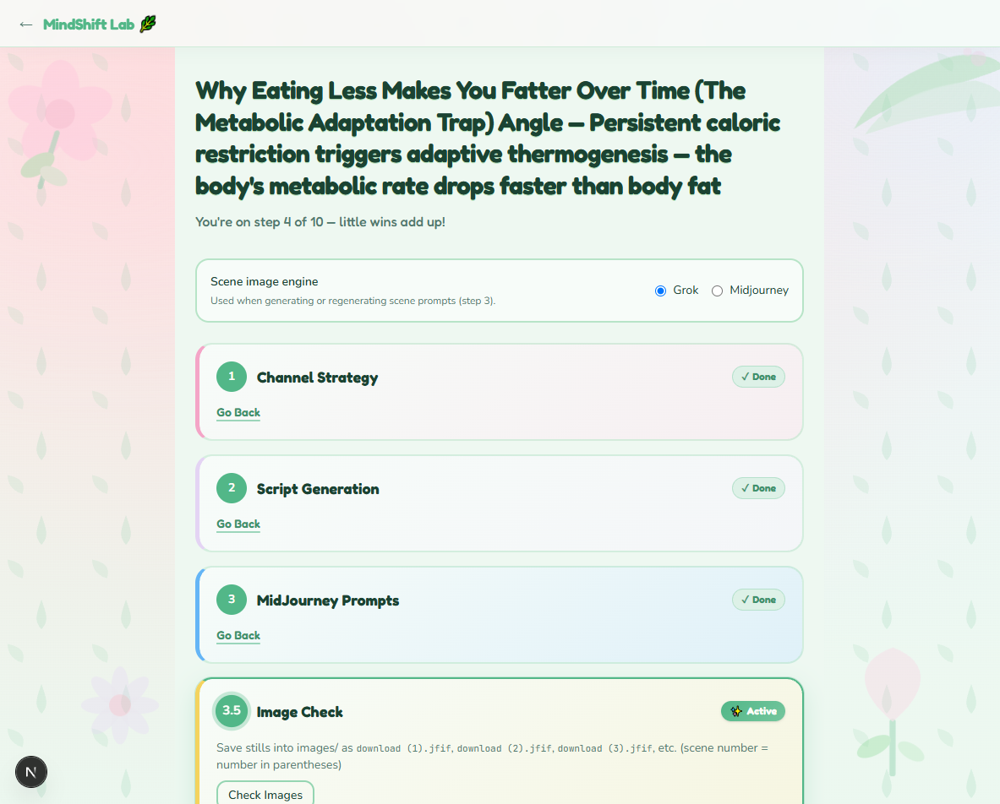
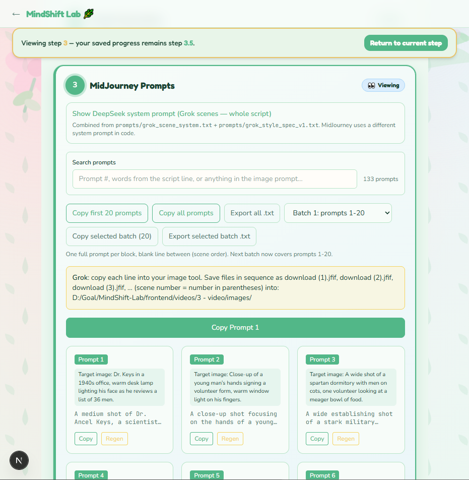
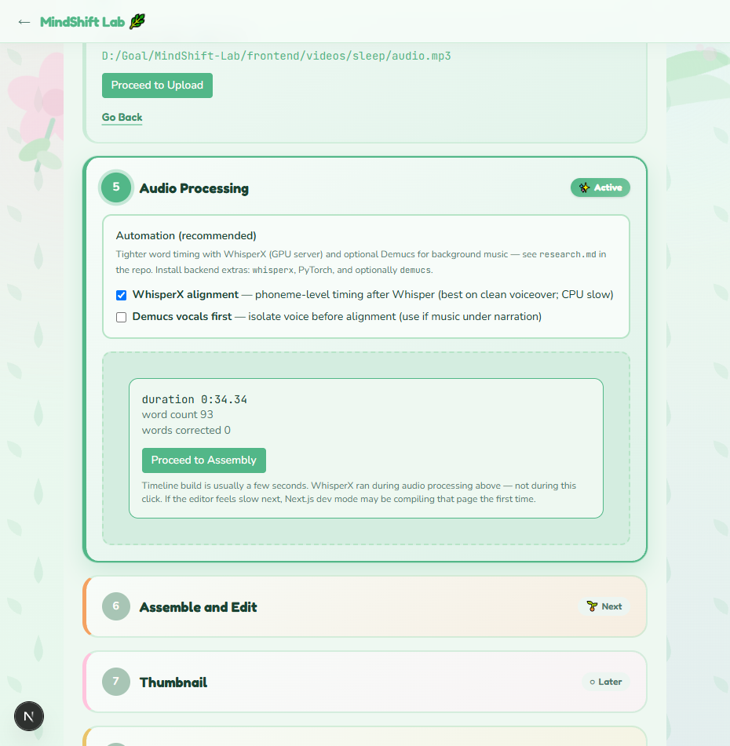
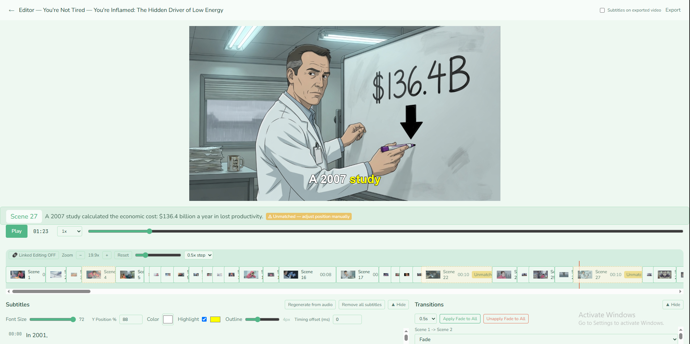
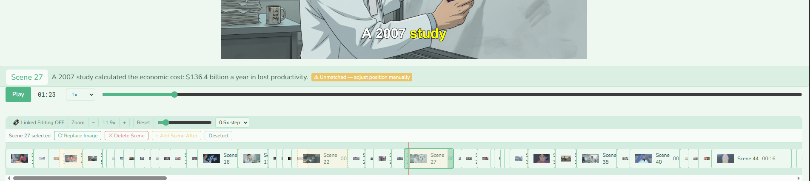
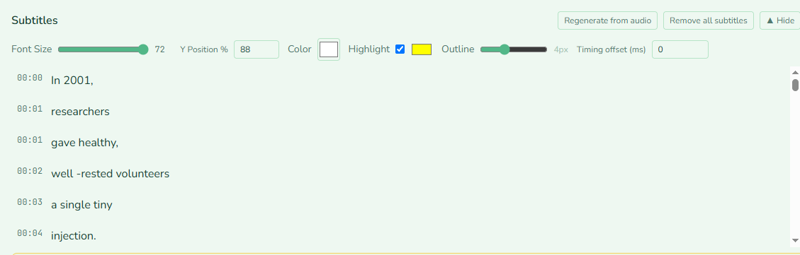
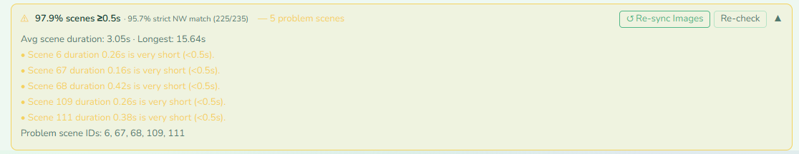
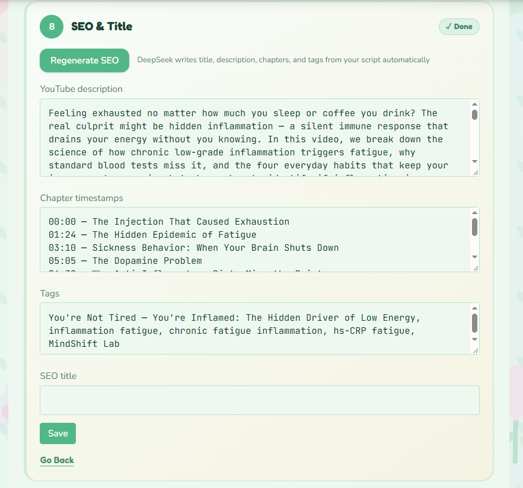

# MindShift Lab

<!-- Screenshot width convention for this file: 720px. Change the width="720" value below to resize all of them. -->

A pipeline that takes a video from script to finished MP4, built so I can make videos without animating them myself.

## Why I built it

I wanted to make videos but had no time to animate them and I'm not an animator. I wanted to use AI as much as possible for the parts that don't need me (Grok is cheap for images, Claude is good at scripts), so I built one system where I click through the steps: script, title, image prompts, images, audio, subtitles, assembly. AI does the generation; I'm there as the human reviewer at each step, because I don't want to hand everything to AI unsupervised.

## Features

**A step-by-step pipeline**, each step reviewable before moving on: channel strategy → script generation → image prompts → image check → script for recording → audio processing → assemble & edit → thumbnail → SEO & title → final review.

<p align="center">
  
  <br>
  <em>Each step as a card: done, active, or locked.</em>
</p>

The image prompts step generates one prompt per scene, ready to paste into Midjourney or Grok.

<p align="center">
  
  <br>
  <em>One generated prompt per scene, with a copy button.</em>
</p>

**Audio-driven sync.** Whisper (free, runs locally) transcribes the voiceover and gives word-level timing.

<p align="center">
  
  <br>
  <em>Transcription and word-level timing, done.</em>
</p>

**An editor I built by using it.** This took the most work and it's the part I'm proudest of. I made my own videos with it, and at every point where I was doing something manually that AI or the app could do instead, I went and built that.

<p align="center">
  
  <br>
  <em>Canvas preview with the current frame.</em>
</p>

What's in there now: a timeline I can drag and trim, zoom in and out, and transitions.

<p align="center">
  
  <br>
  <em>Scenes laid out against the audio, zoomable.</em>
</p>

Editable subtitles too, with automatic audio/image sync.

<p align="center">
  
  <br>
  <em>Karaoke-style, word-by-word highlighting.</em>
</p>

Those Whisper word timings tell the system which image should be on screen at which second, so assembly mostly edits itself, and I usually only have to swap one or two images by hand afterward.

<p align="center">
  
  <br>
  <em>Flags scenes where the image match or timing looks off, before export.</em>
</p>

**SEO & title.**

<p align="center">
  
  <br>
  <em>Generated title, description, and tags.</em>
</p>

## How it works

```
Script ──► Image prompts ──► Images (manual: Midjourney/Grok)
                                        │
Audio (recorded) ──► Whisper (local) ──┤
     word timings                      ▼
                              Editor: timeline, subtitles,
                              image/audio sync, undo/redo
                                        │
                                        ▼
                              ffmpeg export ──► MP4
```

Next.js frontend (the editor, the step-by-step UI) talks to a separate FastAPI backend (transcription, LLM calls, ffmpeg assembly) over a local HTTP API.

## Tech stack

Next.js · FastAPI · Whisper (faster-whisper, local) · ffmpeg · DeepSeek & OpenAI (script, prompt, and SEO generation) · Claude and Grok (used from outside the app, for scripts and images respectively).

## Run it locally

**Prerequisites:** Node.js, Python 3.10+, [ffmpeg](https://ffmpeg.org/) on your PATH.

```bash
# Clone, then backend
git clone https://github.com/Maryam-Nisar-Ahmad/mindshift-lab.git
cd mindshift-lab/backend
python -m venv .venv && .venv\Scripts\activate   # macOS/Linux: source .venv/bin/activate
pip install -r requirements.txt
copy .env.example .env   # add your DEEPSEEK_API_KEY (required); OPENAI_API_KEY is optional
python -m uvicorn main:app --reload --host 127.0.0.1 --port 8050

# Frontend, in a second terminal, from the repo root
npm install
npm run dev
```

Open `http://localhost:3050`.

The actual channel strategy, scriptwriting, and image-prompt text this pipeline was built around are private and not in this repo. `prompts.example/` ships generic placeholders in their place, so every step still runs; it just generates with a plainer, less-tuned prompt than the one I actually use. Drop your own prompt files into a local `prompts/` folder (gitignored) to use real ones.

## Hardest part / what I learned

Getting images and audio to stay in sync took the most work. Whisper's word timings are what made it automatic.

## Known limits

- Built and tested on Windows; the backend should run cross-platform but I haven't verified it elsewhere.
- No hosted demo: this is meant to run locally with your own API keys.
- The prompt library that drives the actual visual style and script quality is private (see above); without it, output quality will be generic.
- I'm the only reviewer in the loop right now. There's no multi-user or team workflow.

## License

MIT (see [LICENSE](LICENSE)).
